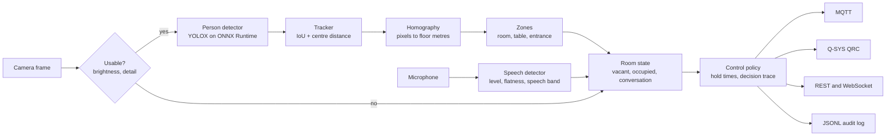
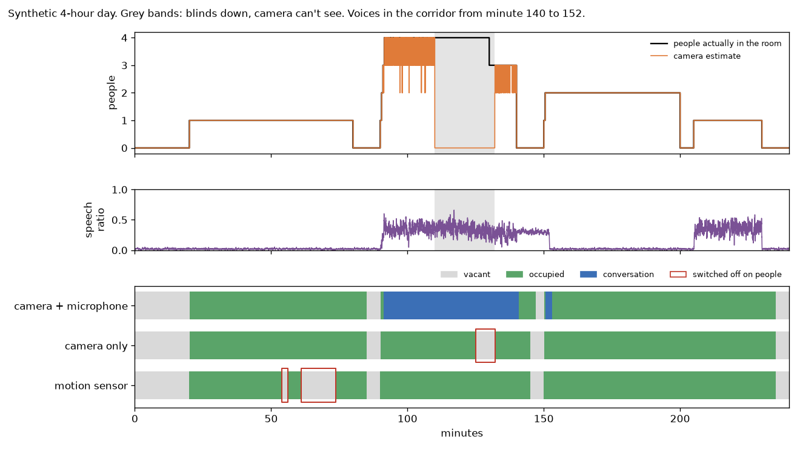

# roomsense

[](https://github.com/KushagraSharma95/roomsense/actions/workflows/ci.yml)

Room occupancy sensing that runs on the device. A camera and a microphone decide whether a room is
empty, in use, or hosting a conversation, and the result becomes lighting, AV and HVAC commands. Video and
audio are processed in memory and dropped; only counts, states and decisions leave the device.

**Status: work in progress.** It runs on recorded video, a webcam and a simulated day. It has not been
deployed in a real building.

## Why

Most rooms decide occupancy with a PIR motion sensor. That works until people sit still: someone reading
gets the lights switched off on them. A camera fixes that, but a camera fails in the dark, for example
during a presentation with the lights down. roomsense uses two signals that fail in different ways. The
camera sees people who sit still, and the microphone hears people the camera can't see. Every automatic
change is logged with the evidence behind it, so "why did the lights go off?" always has an answer.

## Run it locally

```bash
git clone https://github.com/KushagraSharma95/roomsense && cd roomsense
python -m venv .venv && source .venv/bin/activate          # Windows: .venv\Scripts\activate
pip install -e ".[dev]"
```

**1. A simulated day (no camera needed).** Compares a motion sensor, camera only, and camera plus
microphone over a synthetic 4-hour day, sends the decisions to a local mock Q-SYS Core, and writes a
timeline chart and a decision log to `out/sim/`. Add `--days 20` for the averages in the results table
(about a minute).

```bash
roomsense simulate --qrc-mock
```

**2. Real video.** Downloads the detector (checksum verified) and OpenCV's public sample clip, then writes an
annotated video with people blurred.

```bash
roomsense models download nano
curl -L --create-dirs -o samples/vtest.avi https://raw.githubusercontent.com/opencv/opencv/4.x/samples/data/vtest.avi
roomsense run --config configs/sample-video.yaml --video samples/vtest.avi --record out/sample-video/annotated.mp4
```

**3. Your webcam and microphone.** Then open http://127.0.0.1:8080/preview.jpg for the annotated frame
and http://127.0.0.1:8080/status for the live state. Walk out of view for 30 seconds and the room goes vacant.

```bash
pip install -e ".[audio]"
roomsense run --config configs/webcam.yaml --video 0 --audio mic --api
```

Prefer a window? Install `opencv-python` in place of `opencv-python-headless` and add `--show`.

**Tests and speed:**

```bash
pytest                                        # 52 tests, about 15 seconds
roomsense bench --video samples/vtest.avi     # detector latency on your CPU
```

**Docker:** `docker build -t roomsense . && docker run --rm roomsense` runs the simulated day.

## How it works



| Step | Code | What it does |
|---|---|---|
| Detect | `vision/detector.py` | YOLOX-nano (COCO, Apache-2.0) on ONNX Runtime, CPU only, person class only. A background-subtraction detector is included as a no-model baseline. |
| Track | `vision/tracker.py` | Hungarian matching on IoU, then on centre distance for fast movers; a constant-velocity guess bridges short occlusions. |
| Locate | `spatial.py` | A homography from four floor points maps each person's foot point to metres, so zones are drawn on the floor plan, not the image. |
| Listen | `audio.py` | 30 ms frames scored on loudness against a running noise floor, spectral flatness and speech-band energy. No model, nothing recorded. |
| Decide | `fusion.py` | Combines both signals into a room state with hysteresis (rules below). |
| Act | `control.py`, `adapters/` | Maps states to device settings, never switches a device twice within a hold time, and records why. |

**Decision rules (all configurable):**

- The people count is the median over 3 seconds, so one missed frame changes nothing.
- The room becomes occupied once presence has lasted 2 seconds.
- It goes vacant after 5 minutes with nobody seen and nothing heard, or 15 minutes if the camera can't see.
  Anyone tracked in the current frame restarts that timer, so a person walking in just as it runs out
  doesn't get the lights switched off on them.
- When the camera comes back after being dark, it gets a full 5 minutes of clear view before it can call
  the room empty.
- Speech keeps an occupied room on, for example when someone is out of view, but only for 2 minutes after
  the camera last saw anyone, so voices in the corridor can't hold the room for long. Speech never switches
  an empty room on while the camera has a clear view and sees nobody: that is usually a TV or a corridor.
- A conversation means 2 or more people plus speech in at least 20% of the last 10 seconds, sustained for
  10 seconds. It ends after 60 quiet seconds, unless the camera is dark and people are still talking.
- At start-up the devices are synced to the room: an occupied room after a few seconds, an empty one after
  a full vacancy timeout. Lights left on before a restart don't stay on.

Each decision is one JSON line, for example:

```json
{"t": 5476.0, "room": "huddle-room-1", "target": "av", "value": "on", "state": "conversation",
 "reason": "3 people in view and speech in 26% of the last window", "deferred_s": 0.0,
 "evidence": {"t": 5476.0, "people": 3, "people_raw": 3, "zones": {"table": 3, "entrance": 0},
              "speech_ratio": 0.265, "vision_ok": true}}
```

## Results so far

**Simulated days.** `roomsense simulate --days 20` replays a 4-hour day in a 4 m x 6 m room 20 times
with different random noise. Each day has desk work, someone reading very still, a 4-person meeting with
the blinds down for 22 minutes of slides, voices in the corridor for 12 minutes after the meeting, two
people working quietly, and a phone call. Detections, misses, false alarms, speech and motion are all
generated (the assumptions are listed at the top of `sim.py`), so these numbers show the logic behaves as
designed. They are not measurements from a real room.

| Averages over 20 days | Switched off on people, per day | Dark while occupied | On while empty | Meeting precision / recall |
|---|---|---|---|---|
| Motion sensor | 2.5 (1 to 4) | 9.5 min | 19.9 min | n/a |
| Camera only | 1 (every day: the presentation) | 7.3 min | 20.2 min | n/a |
| Camera + microphone | 0 (on every day) | 0.2 min | 22.2 min | 0.94 / 0.99 |

What the table says, including the costs:

- The motion sensor switches the lights off on the still reader and the quiet workers. Camera only loses
  the room during the presentation, when it can't see.
- Camera + microphone never switched off on people. Its 0.2 minutes of "dark while occupied" are the
  2 to 3 seconds it takes to confirm each arrival, where a motion sensor reacts at once.
- It pays for that with about 2 extra minutes of "on while empty" a day, because voices in the corridor
  keep the room on after the meeting. Most of "on while empty" is the 5-minute timeout after people leave,
  the same for all three.
- Its meeting precision is 0.94, not 1: corridor voices plus two quiet people briefly looked like a
  conversation.
- When it can see, the camera's people count is exact 94% of the time (mean absolute error 0.06).

The chart shows day 1. Red outlines mark the lights going off while people were in the room.



**Detector speed** on a 2-core Intel Xeon (2.1 GHz) with ONNX Runtime, 768x576 frames resized to 416x416:

| Model | Mean | p95 | Frames per second |
|---|---|---|---|
| YOLOX-nano | 15.6 ms | 18.8 ms | 64 |
| YOLOX-tiny | 41.5 ms | 51.8 ms | 24 |

The whole pipeline (detection, tracking, zones, overlay and MP4 writing) processes OpenCV's 795-frame
sample clip in about 17 seconds on the same machine.

## Set up your own room

Copy `configs/room.example.yaml` and change two things:

1. **Calibration.** Pick four points on the floor you can see in the image (rug corners, floor tape) and
   write down their pixel positions and their positions in metres. That is all the homography needs.
2. **Zones.** Polygons in metres. A zone named `room` is special: only people inside it are counted, so
   someone walking past a glass wall is ignored.

```yaml
camera:
  image_points: [[95, 560], [700, 560], [560, 230], [215, 230]]
  floor_points: [[0.0, 0.0], [4.0, 0.0], [4.0, 6.0], [0.0, 6.0]]
zones:
  - name: room
    polygon: [[0.0, 0.0], [4.0, 0.0], [4.0, 6.0], [0.0, 6.0]]
  - name: table
    polygon: [[1.0, 2.0], [3.0, 2.0], [3.0, 4.5], [1.0, 4.5]]
policy:
  min_hold_s: 30
  actions:
    vacant:       {lights: "off", av: standby, hvac: setback}
    occupied:     {lights: work, hvac: occupied}
    conversation: {lights: meeting, av: "on", hvac: occupied}
```

## Outputs

**MQTT** (`outputs.mqtt.enabled: true`):

| Topic | Payload |
|---|---|
| `roomsense/<room>/status` | retained JSON: state, people, zones, speech ratio, camera health |
| `roomsense/<room>/<device>/set` | `{"value": "meeting", "state": "...", "reason": "..."}` |
| `roomsense/<room>/decisions` | every decision with its evidence |
| `roomsense/<room>/online` | `true` / `false` (last will) |

**Q-SYS QRC** (`outputs.qrc.enabled: true`). QRC is the JSON-RPC 2.0 protocol a Q-SYS Core accepts on TCP
port 1710. The client logs on, keeps the socket alive with `NoOp`, and maps each decision onto a Named
Control (`Control.Set`) or a component control (`Component.Set`):

```yaml
controls:
  lights.meeting: {control: LightingScene, value: 2}
  av.on:          {component: Display, control: power, value: 1}
```

The control names are examples; use the ones in your design. Commands go through a background worker, so the
video loop never waits on the network. If the Core is unreachable, the latest setting for each device is sent
once it is back, after logging on again. The client is tested against the mock Core in `adapters/qrc_mock.py`,
not yet against real hardware.

**HTTP** (`--api`): `GET /status`, `GET /decisions`, `GET /preview.jpg` (people blurred) and a WebSocket at
`/ws` that pushes every status change. It binds to 127.0.0.1 unless you change it.

## Privacy

- Frames and audio are analysed in memory and never stored, unless you ask for `--record`.
- Previews and recordings blur every person the detector finds, including people whose track isn't
  confirmed yet (`--no-blur` turns that off). Someone the detector misses in a frame isn't blurred in that
  frame, so treat recordings as personal data.
- Only counts, states and decisions are published.

## Limitations

- YOLOX-nano is trained on COCO photos. Ceiling-mounted and fisheye cameras will need a fine-tuned model.
- The tracker has no re-identification: someone who leaves the view comes back with a new ID. Counts are
  unaffected, but per-person dwell times would be.
- The speech detector is hand-built signal processing, not a trained model. A TV counts as speech, and
  loud voices outside can briefly make two quiet people look like a meeting.
- In a windowless room at night, a quiet person walking into a dark room isn't seen until a light comes on.
  An IR-capable camera or a door sensor would close that gap; neither is supported yet.
- The simulated results depend on the stated assumptions.
- The QRC client covers the subset of the protocol listed above and has only met the mock Core.
- No BACnet or Modbus output yet.

## Next

- Evaluate on recorded rooms with hand-labelled counts.
- INT8 quantization and benchmarks on an ARM edge box.
- BACnet/IP output for building-management systems.
- Direction of arrival from a microphone array, to tell who is speaking.

## Project layout

```
configs/          example room, webcam and sample-video configs
src/roomsense/
  vision/         person detector and tracker
  spatial.py      homography and zones
  audio.py        speech detector
  fusion.py       room state machine
  control.py      device policy and decision records
  pipeline.py     one step per frame, plus the overlay
  adapters/       console, JSONL, MQTT, Q-SYS QRC (+ mock Core)
  api.py          REST, WebSocket and preview
  sim.py          simulated day and scoring
  cli.py          roomsense run | simulate | bench | models
tests/            52 tests, no network needed except for the optional model test
```

## License

MIT. The YOLOX weights (Apache-2.0) are downloaded from the official release and checked against a pinned
SHA-256; they are not stored in this repository. The sample clip comes from OpenCV's repository and is not
included either.

Built by [Kushagra Sharma](https://www.linkedin.com/in/kushagra-sharma-127950116/).
